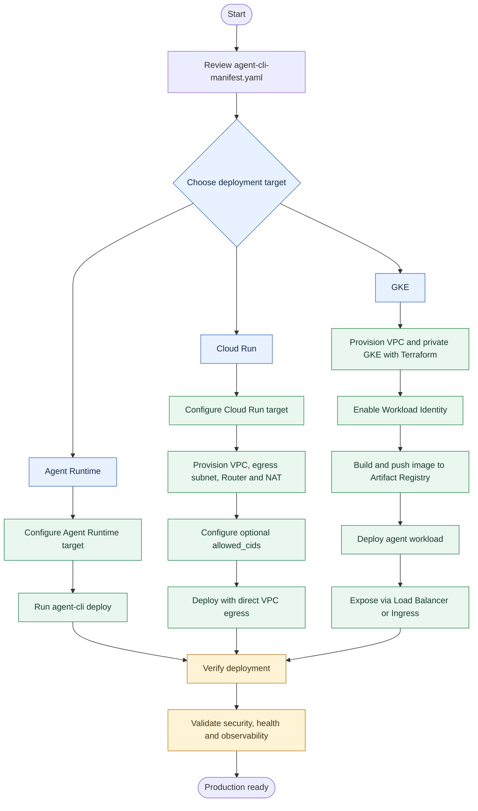

# AI Agent Production Deployment Guide

This guide outlines three production deployment targets for an AI agent using the `agents-cli` tool.

> **Before you begin:** Confirm that your chosen deployment target is configured in `agent-cli-manifest.yaml`. CLI commands and manifest fields may vary by version, so verify the exact syntax against the documentation for your installed `agents-cli` release.

## Deployment Options at a Glance

| Target | Best suited for | Key capabilities / considerations |
|---|---|---|
| **Agent Runtime** | Teams seeking minimal operational overhead | Managed infrastructure, multi-turn memory, and native user authentication |
| **Cloud Run** | Serverless deployments requiring custom networking | VPC connectivity, controlled egress, and optional network allow-listing |
| **Google Kubernetes Engine (GKE)** | Teams requiring Kubernetes-level control | HPA/VPA scaling, node auto-provisioning, and customizable cluster infrastructure |

## 1. Agent Runtime — Managed Infrastructure

Best for teams that want to minimize infrastructure management.

### Key features

- Managed runtime infrastructure.
- Instant multi-turn memory.
- Native user authentication.

### Workflow

1. Configure the deployment target as **Agent Runtime** in `agent-cli-manifest.yaml`.
2. Set the target using the command documented for your installed CLI. The supplied workflow describes this as:

   ```bash
   set agent runtime
   ```

3. Deploy the agent:

   ```bash
   agent-cli deploy
   ```

4. Verify the deployment and test the agent's authentication and multi-turn conversation behavior.

> **Note:** The commands above reflect the supplied workflow. Check the current CLI documentation for the exact command syntax.

## 2. Cloud Run — Serverless with Custom Networking

Ideal for serverless deployments that need custom networking or granular control over outbound traffic.

### Workflow

1. Configure the target as **Cloud Run** in `agent-cli-manifest.yaml`.
2. Provision the required networking components:
   - Virtual Private Cloud (VPC).
   - Egress subnet.
   - Cloud Router.
   - Cloud NAT gateway.
3. If network allow-listing is required, configure the optional `allowed_cids` environment variable according to your application's expected format.
4. Deploy the agent to Cloud Run with direct VPC egress attached to the configured subnet.
5. Verify that the service can reach required destinations and that disallowed network paths are blocked as intended.

### Production considerations

- Restrict IAM permissions to the minimum required.
- Confirm egress routing and firewall rules before production traffic is enabled.
- Store secrets in an approved secrets manager rather than committing them to source control.
- Add monitoring, logging, and alerting for the deployed service.

## 3. Google Kubernetes Engine (GKE)

Recommended for teams that require full Kubernetes control, including workload scaling and cluster-level configuration.

### Workflow

1. Use Terraform to provision the custom VPC infrastructure.
2. Create a private GKE cluster and enable Workload Identity.
3. Build the agent's container image.
4. Push the image to Artifact Registry.
5. Deploy the agent as a Kubernetes workload in the cluster.
6. Expose the service through a LoadBalancer service or an Ingress, based on your networking and security requirements.
7. Configure health checks, resource requests and limits, and scaling policies such as Horizontal Pod Autoscaling (HPA). Use Vertical Pod Autoscaling (VPA) where appropriate.
8. Verify application health, connectivity, access controls, and observability before directing production traffic to the agent.

### Production considerations

- Use least-privilege Kubernetes RBAC and Google Cloud IAM.
- Keep credentials and secrets out of container images and Git.
- Define resource requests and limits.
- Configure readiness and liveness probes.
- Monitor pod health, resource usage, latency, and errors.
- Test cluster upgrades, scaling behavior, and recovery procedures.

## Deployment Flow Diagram

GitHub renders the following Mermaid diagram directly in Markdown.



## Pre-Production Checklist

- [ ] Confirm the target and required settings in `agent-cli-manifest.yaml`.
- [ ] Verify CLI commands against the installed version's documentation.
- [ ] Apply least-privilege IAM and access controls.
- [ ] Keep secrets out of source control and container images.
- [ ] Configure networking, ingress, and egress restrictions.
- [ ] Enable logging, monitoring, and alerting.
- [ ] Test health checks, failure handling, and scaling behavior.
- [ ] Validate the deployment in a non-production environment before release.

## Summary

Choose **Agent Runtime** for managed operations, **Cloud Run** for serverless deployments with custom networking, or **GKE** for Kubernetes-level control. Regardless of the target, validate security, connectivity, observability, and recovery behavior before production use.
