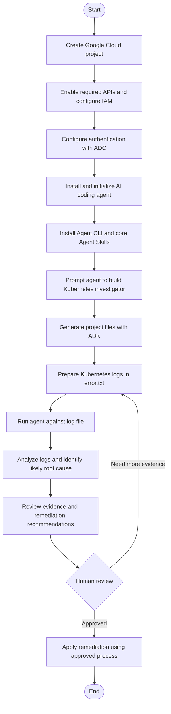

# Kubernetes Investigation Agent Setup Guide

A step-by-step guide to building a Kubernetes investigation agent using the **Gemini Enterprise Agent Platform** and **Agent Development Kit (ADK)**.

## Prerequisites

Before you begin, make sure you have:

- Access to a Google Cloud account and permission to create or configure a project.
- A working terminal environment.
- Python and the package/tooling required by your chosen agent workflow.
- An AI coding agent, such as Google Antigravity, installed and available in your environment.

> **Note:** CLI names and commands can change between releases. Confirm the current command syntax in the official documentation for the tools and versions you install before running commands.

## Workflow Diagram

This Mermaid flowchart is embedded directly in the Markdown. GitHub automatically renders Mermaid diagrams in README files.



**Flow summary:** Prepare Google Cloud → authenticate → install tools and skills → build the agent → provide logs → inspect findings → have a human validate recommendations before making cluster changes.

## 1. Prepare the Google Cloud Environment

1. Create a dedicated Google Cloud project for your agent.
2. Open the Google Cloud console and locate the relevant Agent Platform services.
3. Enable the APIs required by your chosen Agent Platform and ADK workflow.
4. Confirm that your account has the necessary IAM permissions for development and deployment.

## 2. Configure Authentication and Credentials

1. Open the Agent Platform dashboard and locate the API key or authentication setup instructions.
2. For local development, choose **Application Default Credentials (ADC)** when supported by your workflow.
3. Run the authentication command shown in the official Google Cloud documentation and follow the prompts to sign in.
4. Verify that the active credentials belong to the intended Google Cloud project.

Keep credentials private. Do not commit API keys, access tokens, service-account keys, or other secrets to GitHub. Use environment variables or an approved secrets manager where appropriate.

## 3. Initialize the AI Coding Agent

1. Download and install your preferred AI coding agent, such as Google Antigravity.
2. Open your project directory and initialize the coding agent according to its documentation.
3. Confirm that the agent is connected to the intended Google Cloud project and can access the Gemini models required by your workflow.

## 4. Install and Configure the Agent CLI

1. Open a new terminal tab.
2. Run the setup command specified by the CLI's official documentation. The original workflow supplied for this guide lists:

   ```bash
   uvx Google agent cla setup
   ```

3. Follow the authentication and installation prompts.
4. Verify that the expected seven core Agent Skills are available in your coding-agent interface, including skills for ADK code, deployment, evaluation, and observability.

> **Important:** The command above is reproduced from the supplied notes. Check the official CLI documentation for the exact package name, capitalization, and command syntax before running it.

## 5. Build the Agent

Use a natural-language prompt to describe the agent you want to create. For example:

> Build a simple Kubernetes investigation agent in Python. It should accept Kubernetes cluster logs as input, identify likely causes of errors, cite supporting evidence from the logs, and recommend safe remediation steps. Do not execute changes against a live cluster; provide recommendations for a human to review.

The Agent CLI and Agent Development Kit can then help generate the project's file structure, dependencies, and configuration files.

Review the generated code before using it. Ensure that the agent treats logs as untrusted input and does not expose secrets that may appear in log output.

## 6. Run and Test the Agent

1. Prepare an input file, for example `error.txt`, containing relevant Kubernetes logs.
2. Run the agent using the command and input-file syntax documented for your installed CLI. The supplied workflow describes this as running `agent CLI run` followed by the log-file path.
3. Review the output and check that it includes:
   - **Likely root cause**
   - **Supporting evidence** from the provided logs
   - **Recommended remediation steps**
   - **Uncertainties or additional checks** needed to confirm the diagnosis

Test the agent with representative logs, including incomplete and misleading examples. Validate its findings against Kubernetes events, pod descriptions, and other trusted sources before acting on its recommendations.

## Security and Operational Checklist

- [ ] Use a dedicated Google Cloud project.
- [ ] Enable only the APIs required for your workflow.
- [ ] Use Application Default Credentials or another approved authentication method.
- [ ] Keep secrets and credentials out of source control.
- [ ] Review generated code and dependencies before execution.
- [ ] Treat cluster logs and other input data as untrusted.
- [ ] Test recommendations in a safe environment before applying them to production.
- [ ] Require human review before making changes to a live Kubernetes cluster.

## Further Reading

Consult the current official documentation for Google Cloud, the Gemini Enterprise Agent Platform, the Agent Development Kit (ADK), and your selected AI coding agent for version-specific setup instructions.
